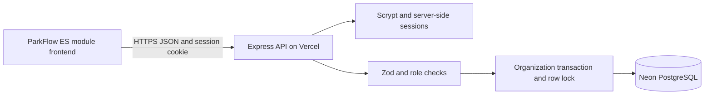

# Full-stack application design

## Architecture

The browser loads the authenticated state and invokes named API operations. It never sends an entire replacement database. The server validates every operation, enforces ownership through the signed-in organization, locks its state row, applies the change and commits the result. Conflicting allocations return HTTP 409. API responses contain the authoritative snapshot and revision; the browser discards older responses.

## Tables

- `organizations`: workspace identity and creation timestamp.
- `users`: globally unique email, workspace ID, display name, scrypt hash and role.
- `auth_sessions`: SHA-256 digest of the opaque cookie, user ID, CSRF token and expiration. Raw cookie values are not stored in the database.
- `parking_state`: one JSONB document and revision per organization. Contains configured lots, bays, reservations, sessions, customers, shifts, alerts, receipts, settings and recent actor-attributed activity.
- `auth_limits`: persistent time-window counters for authentication attempts.

Schema creation is idempotent and serialized with an advisory transaction lock on PostgreSQL. For a larger deployment, introduce versioned migrations rather than modifying production DDL in place.

## API

All payloads are JSON. Authenticated mutations require `X-CSRF-Token`, returned by sign-in or `/api/auth/me`. Cookies are HTTP-only, SameSite Lax and Secure in production. Cross-origin browser mutations are rejected.

| Endpoint                  | Access            | Purpose                                        |
| ------------------------- | ----------------- | ---------------------------------------------- |
| GET `/api/health`         | Public            | Database-backed service readiness              |
| POST `/api/auth/register` | Public            | Create a workspace and administrator           |
| POST `/api/auth/login`    | Public            | Sign in with email and password                |
| GET `/api/auth/me`        | Signed in         | Identity and CSRF token                        |
| POST `/api/auth/logout`   | Signed in         | Revoke the current session                     |
| POST `/api/auth/password` | Signed in         | Change password and revoke other sessions      |
| GET `/api/state`          | Signed in         | Authoritative workspace records and aggregates |
| POST `/api/actions`       | Operator or admin | Apply a validated parking operation            |
| GET/POST `/api/users`     | Admin             | List/create workspace login accounts           |
| DELETE `/api/users/:id`   | Admin             | Revoke another workspace account               |

`POST /api/actions` takes `{ "type": "book", "data": { ... } }`. Supported operation types:

- `book`: `slot`, `name`, `plate`, `at` (epoch milliseconds), `hours`, `method`, optional `email`, `vehicle`, `customerId`.
- `checkin`, `cancel`: reservation `id`.
- `extend`: session `id`, integer `hours`.
- `checkout`: session `id`, `method`, and `reference` for non-cash payment.
- `hold`: bay `slot`, maintenance `reason`.
- `release`: bay `slot`. Occupied bays must be checked out instead.
- `alert`: incident `id`, `action` of `ack` or `dismiss`; `ackall`: no fields.
- `customer`: optional `id`, `name`, `email`, `plan`, `ev`, `status`.
- `staff` (admin): optional `id`, `name`, `email`, `role`, `lotId`, `shift`, `status`.
- `settings` (admin): `name`, `email`, `occupancyThreshold`, `reservationGrace`.
- `facility` (admin): optional `id`, `name`, `addr`, `cap`, `rate`, `zones`.

Errors use `{ "error": "Human-readable explanation" }`. Codes distinguish validation (400), sign-in (401), permission/CSRF (403), missing records (404), conflicts (409), unsupported content (415), rate limits (429) and service failures (500). Passwords, SQL and connection strings are not returned in errors.

## Transaction invariants

1. A bay is free, reserved, occupied or in maintenance. Only free bays can be booked or held.
2. One confirmed reservation owns its bay by reservation ID. Only that reservation can check in there.
3. Check-in creates a session linked to the reservation and customer. Repeated check-in fails.
4. Extension changes expected departure and resolves the overstay state, without changing the agreed rate.
5. Checkout calculates the charge server-side, records one payment, updates customer spend and frees the bay atomically. Duplicate checkout fails.
6. Cancellation/no-show frees only the bay still owned by that reservation.
7. Facility capacity and zones cannot change while a bay in that facility is committed or in maintenance. Existing session rates remain unchanged when a tariff changes.
8. Viewer accounts cannot mutate records. Operator accounts cannot change configuration, shifts or login access.

## Security and operations

Use a pooled PostgreSQL URL with TLS. No database secrets are included in frontend code. Do not use a production database in automated tests; the integration suites create isolated PGlite databases. Browser tests create and exercise their own temporary workspace without writing to Neon.

Use the Neon dashboard's backup/restore facilities appropriate to your selected plan. Before schema changes, export the database with PostgreSQL tooling and verify restoration in a separate project. Monitor API failures in Vercel and database utilization in Neon. A successful health request confirms that schema initialization and database access work; it does not certify external integrations.

Sessions expire after seven days. Password changes revoke existing sessions, and account removal cascades its sessions. Login rate limits are stored in the database; a supplementary per-process request limiter reduces bursts. There is no email password-recovery integration; administrators can remove/recreate member accounts. Workspace owners should retain their credentials securely.

Recent activity is capped at 500 events per workspace and is operational history, not an immutable compliance audit trail. Retain externally backed-up audit logs if required by your organization. The application is a functional parking-management release with manual payment verification; payment-gateway certification, device commissioning and formal accessibility/security audits remain separate work.
