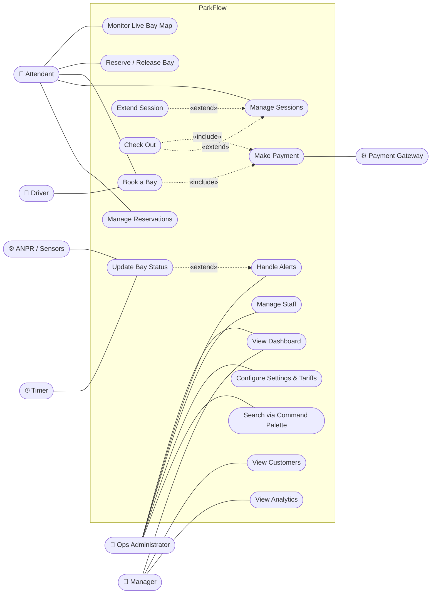

# Experiment 4 — UML Use Case Diagram & Use Case Scenarios

## Aim
Model ParkFlow's functional requirements as a use case diagram and describe the
main use cases as scenarios.

## 1. Actors

| Actor | Type | Goal |
|---|---|---|
| Ops Administrator | Primary | Configure and oversee the whole estate |
| Attendant | Primary | Handle vehicles at the facility |
| Manager | Primary | Track revenue and customers |
| Driver | Primary | Book a bay |
| Payment Gateway | Secondary (system) | Authorise payments |
| ANPR Camera / Sensors | Secondary (system) | Report bay & vehicle events |
| Clock (Timer) | Secondary | Triggers the 4-second live refresh |

## 2. Use case diagram

Mermaid has no native use case diagram, so actors are drawn as rounded nodes and use cases as stadium-shaped nodes inside the system boundary.

**Generalisation:** Ops Administrator inherits every Attendant and Manager use case.

## 3. Use case scenarios

### UC-4 Book a Bay

| Field | Description |
|---|---|
| **ID / Name** | UC-4 Book a Bay |
| **Primary actor** | Attendant (or Driver via kiosk/web) |
| **Secondary actor** | Payment Gateway |
| **Pre-condition** | User is on any page; at least one free bay exists in the chosen facility |
| **Post-condition** | Selected bay status = *reserved*; a reservation with status *confirmed* is stored; confirmation toast shown |
| **Trigger** | User clicks **New Reservation** / **Manual Check-In**, or picks "New booking" in the command palette |

**Main success scenario**
1. System opens the booking wizard at step 1 and lists the 4 facilities, each with its free-bay count and hourly rate.
2. User selects a facility and clicks **Continue**.
3. System shows up to 24 free bays in that facility (EV bays marked), a duration list (1–24 h) and a start time.
4. User selects a bay and duration, then clicks **Continue**.
5. System shows driver name, plate and payment method fields, plus a summary with **Total = rate × hours**.
6. User enters the details, chooses UPI/Card/Wallet/FASTag and clicks **Confirm & Pay**.
7. «include» UC-5 Make Payment.
8. System marks the bay *reserved*, creates reservation `RSV-xxxx`, closes the wizard and shows "Booking confirmed".

**Alternate / exception flows**
- **4a. No bay selected:** system shows the warning "Pick a bay" and stays on step 2.
- **2a/4b. Back:** user clicks **Back**; system returns to the previous step; facility, bay and duration are kept (name/plate typed on step 3 are not).
- **6a. Name or plate left blank:** system uses "Walk-in Guest" / a generated temporary plate.
- **7a. Payment declined:** system shows an error and keeps the wizard open on step 3 *(back-end release)*.
- **\*a. Cancel / Esc:** wizard closes and nothing is saved.

### UC-3 Reserve / Release Bay

| Field | Description |
|---|---|
| **Primary actor** | Attendant |
| **Pre-condition** | Live Bay Map is open |
| **Post-condition** | Bay status changed and map repainted |

**Main flow:** 1. Attendant clicks a bay. 2. System shows bay details (status, type, rate; for taken bays, plate, time occupied and linked session). 3a. If the bay is free, attendant clicks **Reserve Bay**; system sets *reserved* and plate = PENDING and shows "held for 30 minutes". 3b. If the bay is taken, attendant clicks **Release Bay**; system sets *free* and clears the plate and time. 4. Map and KPIs refresh.
**Alternate:** 3c. **Hold:** bay is flagged for maintenance (warning toast).

### UC-6 Manage Sessions

| Field | Description |
|---|---|
| **Primary actor** | Attendant / Ops Administrator |
| **Post-condition** | Session list filtered/sorted as requested; selected session extended or closed |

**Main flow:** 1. User opens **Sessions**. 2. System shows KPI tiles and the session table (12 per page). 3. User types in search and/or picks Status/Facility/Payment filters. 4. System filters instantly, updates "N records" and resets to page 1. 5. User clicks a column header to sort (↑ then ↓). 6. User clicks a row; system opens the session details. 7. User picks **Extend 1h** or **Check Out**.
**Exception:** 4a. No match: system shows the "No results" empty state.

### UC-10 Handle Alerts

**Main flow:** 1. Supervisor opens **Alerts**; badge shows unacknowledged count. 2. Filter All / Open / Acknowledged. 3. Click **Ack** on one alert or **Acknowledge All**. 4. Badge count updates.
**Alternate:** 3a. **Dismiss (✕)** removes the alert from the list.

### UC-14 Update Bay Status (system)

**Actor:** Timer / sensors. **Flow:** every 4 s the system flips 1–3 random bays (free ↔ occupied/reserved), re-prices active sessions, may append an activity-feed event, and notifies all subscribed views to repaint.
