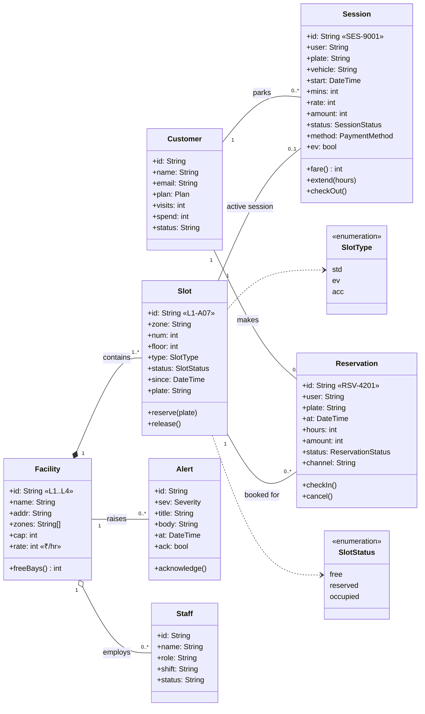
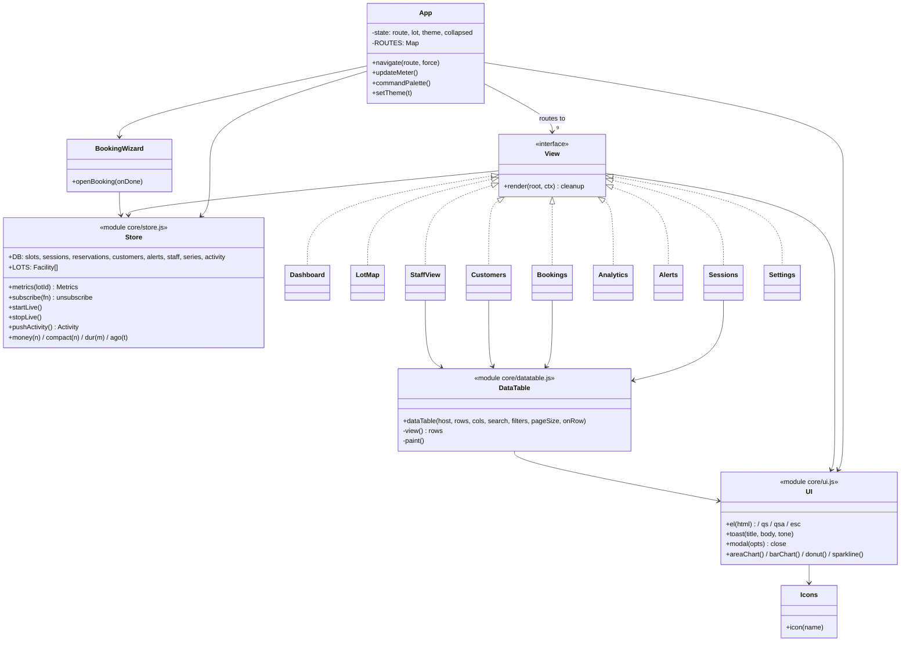
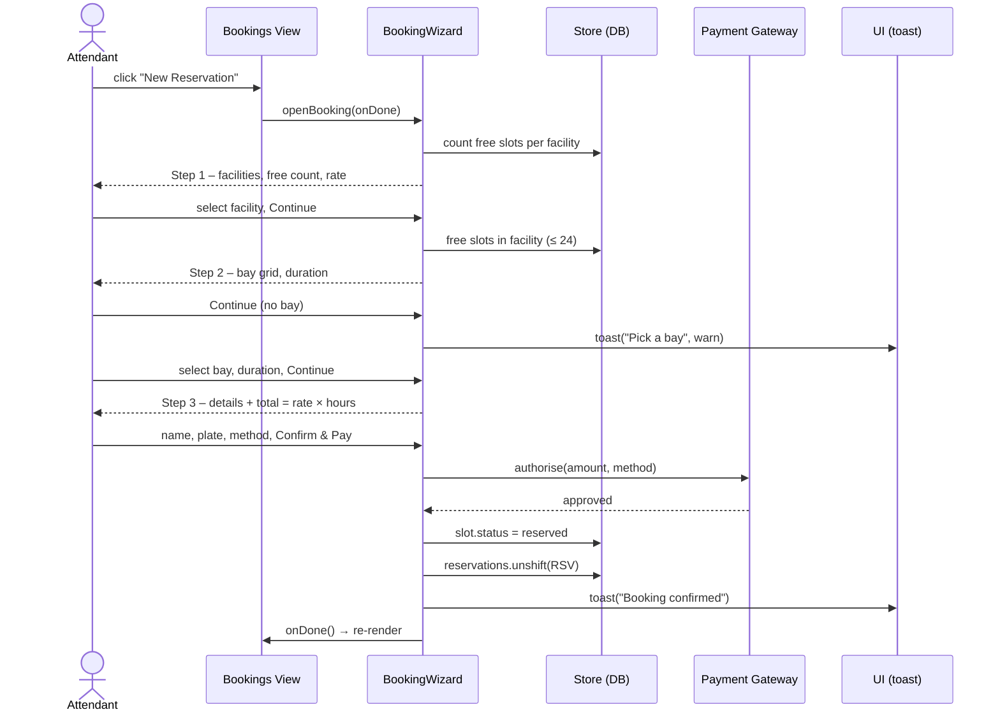
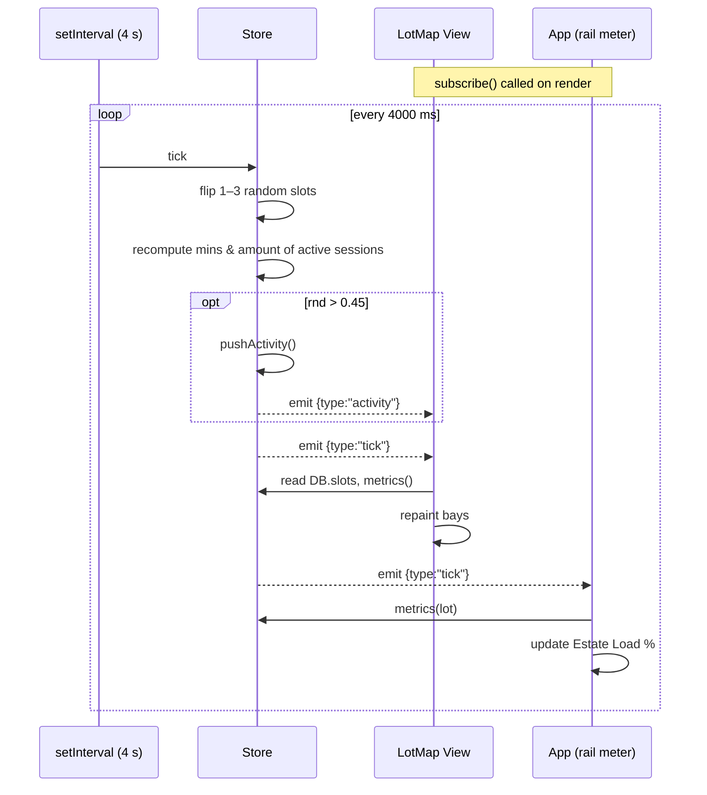
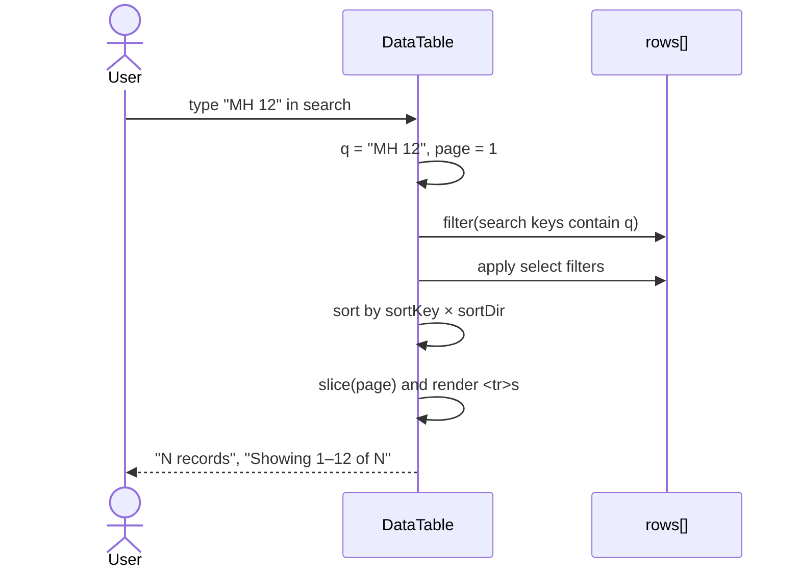

# Experiment 5 — UML Class Diagram & Sequence Diagrams

## Aim
Model ParkFlow's static structure (classes and relationships) and the order of
messages in its key interactions.

## 1. Class diagram — domain model

## 2. Class diagram — software (module) design

ParkFlow uses ES modules rather than classes. Each module is modelled as a class
whose members are its exported functions.

Design notes: every **View** implements the same `render(root, ctx)` contract, so the
router can treat them uniformly (Strategy pattern). **Store** is a single source of
truth with publish/subscribe (Observer pattern).

## 3. Sequence diagram — Book a Bay (UC-4)

## 4. Sequence diagram — live update tick (UC-14)

## 5. Sequence diagram — search & filter sessions (UC-6)

