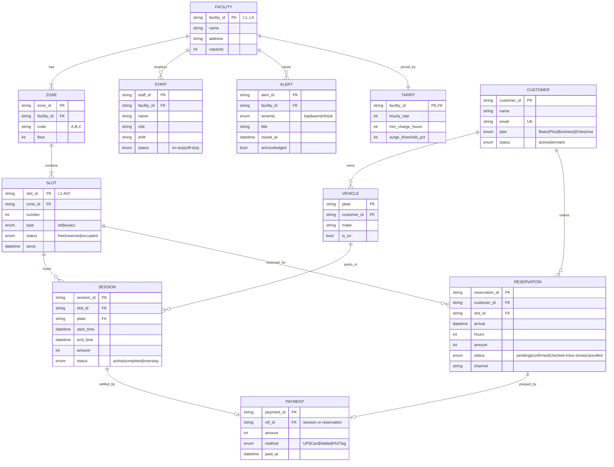
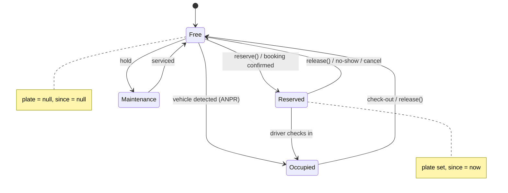
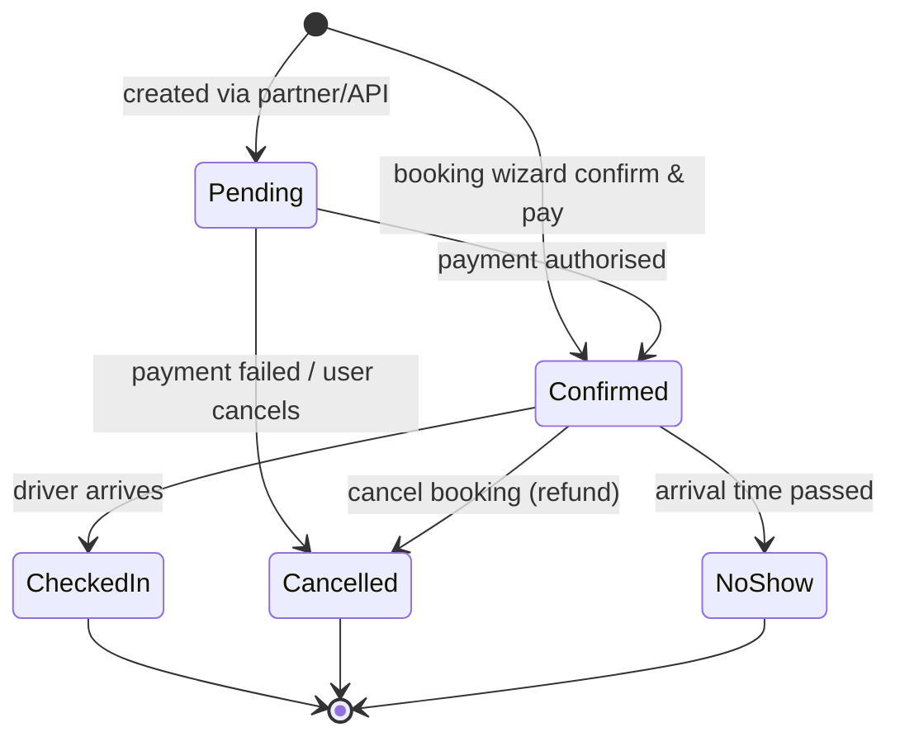
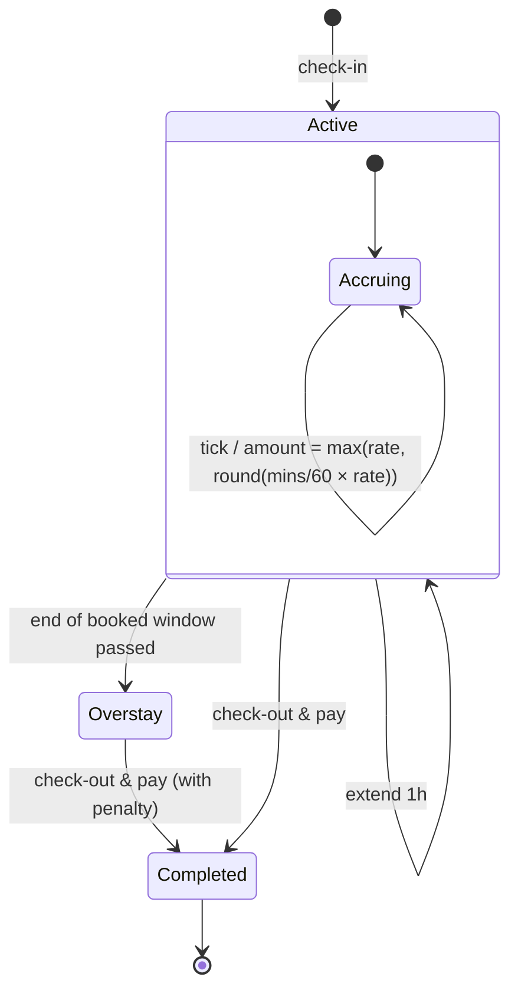
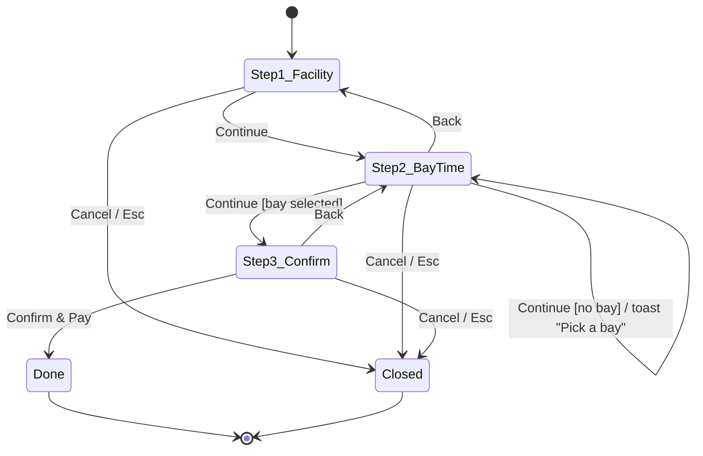
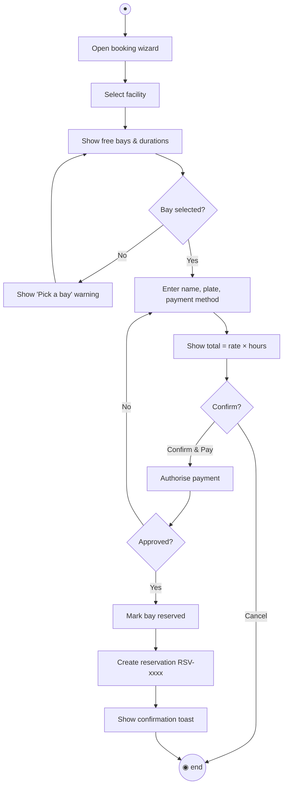
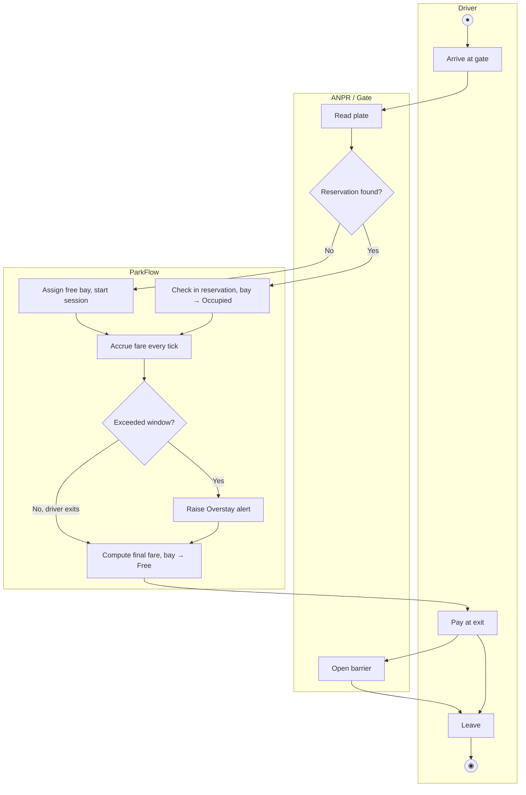
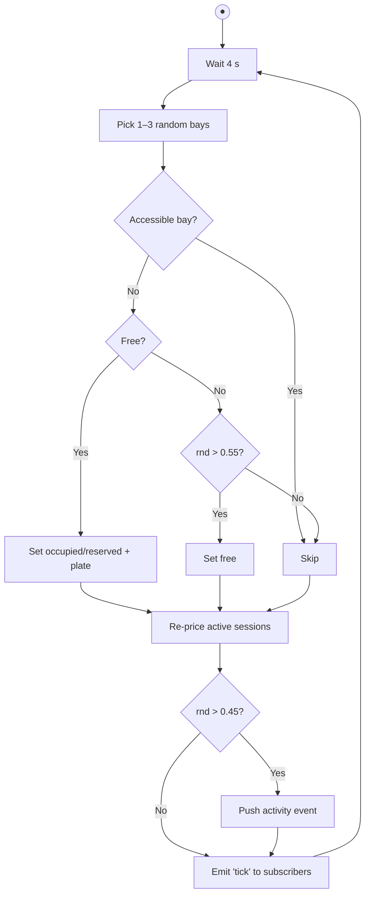

# Experiment 6 — E-R Modelling, State-chart & Activity Modelling

## Aim
Model ParkFlow's data as an E-R diagram, the lifecycles of its key objects as
state charts, and its main workflows as activity diagrams.

## 1. E-R diagram

**Relational schema (3NF):**
Facility(**facility_id**, name, address, capacity) ·
Zone(**zone_id**, *facility_id*, code, floor) ·
Slot(**slot_id**, *zone_id*, number, type, status, since) ·
Tariff(***facility_id***, hourly_rate, min_charge_hours, surge_threshold_pct) ·
Customer(**customer_id**, name, email, plan, status) ·
Vehicle(**plate**, *customer_id*, make, is_ev) ·
Session(**session_id**, *slot_id*, *plate*, start_time, end_time, amount, status) ·
Reservation(**reservation_id**, *customer_id*, *slot_id*, arrival, hours, amount, status, channel) ·
Payment(**payment_id**, ref_id, amount, method, paid_at) ·
Staff(**staff_id**, *facility_id*, name, role, shift, status) ·
Alert(**alert_id**, *facility_id*, severity, title, raised_at, acknowledged)

## 2. State-chart diagrams

### 2.1 Parking bay (Slot)

### 2.2 Reservation

### 2.3 Parking session

### 2.4 Booking wizard (UI)

## 3. Activity diagrams

### 3.1 Book a bay

### 3.2 Vehicle entry → exit (with swim-lanes)

### 3.3 Live refresh cycle

