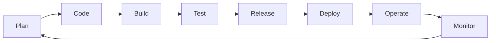
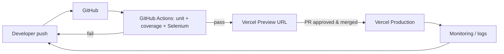

# Experiment 8 — DevOps, Cloud Computing, Virtualization & DevOps Tools

## Aim
Study DevOps, cloud computing and virtualization, and plan how ParkFlow moves to a DevOps workflow.

## 1. Introduction to DevOps

DevOps joins **Dev**elopment and IT **Op**erations into one team that shares
responsibility for building, releasing and running software. Its goals are short
lead time, frequent and low-risk releases, and fast recovery.

**CALMS principles:** Culture (shared ownership) · Automation (build/test/deploy) ·
Lean (small batches) · Measurement (metrics, logs) · Sharing (knowledge, tools).

**DevOps lifecycle (∞ loop):**



| Phase | ParkFlow practice |
|---|---|
| Plan | Product backlog / sprint board (user stories US-01…US-11) |
| Code | Git, feature branches, pull requests |
| Build | No build step: static ES modules |
| Test | `npm test` (unit), `npm run coverage`, `npm run test:e2e` (Selenium) |
| Release | Merge to `main` after checks pass |
| Deploy | Vercel deploys automatically on push; preview URL per pull request |
| Operate | Vercel edge CDN, HTTPS |
| Monitor | Vercel Analytics / runtime logs; in-app Alerts module for facility hardware |

### DORA metrics (targets for ParkFlow)
Deployment frequency: daily · Lead time for changes: < 1 day · Change failure rate: < 15 % · Time to restore: < 1 h (instant rollback to previous Vercel deployment).

## 2. Cloud computing

**Definition (NIST):** on-demand network access to a shared pool of configurable
computing resources that can be provisioned quickly with minimal management effort.

**Five characteristics:** on-demand self-service, broad network access, resource
pooling, rapid elasticity, measured service.

| Service model | What you manage | Example | ParkFlow use |
|---|---|---|---|
| IaaS | OS, runtime, app | AWS EC2, Azure VM | — |
| PaaS | App + data | Vercel, Heroku, Google App Engine | **Hosting the SPA** |
| SaaS | Nothing (just use it) | Gmail, Salesforce | **ParkFlow itself, sold to operators** |
| FaaS / Serverless | Functions | AWS Lambda, Vercel Functions | Future booking/payment API |

**Deployment models:** public, private, hybrid, community. ParkFlow uses the public
cloud. A large airport operator may want a hybrid set-up, with ANPR processing on-site and the dashboard in the cloud.

## 3. Virtualization

Virtualization runs several isolated virtual machines (VMs) on one physical host
through a **hypervisor**.

| | Type 1 (bare-metal) | Type 2 (hosted) |
|---|---|---|
| Runs on | Hardware directly | A host OS |
| Examples | VMware ESXi, Hyper-V, KVM, Xen | VirtualBox, VMware Workstation, Parallels |

**Containers** (Docker) virtualize the OS instead of the hardware. They share the
host kernel, start in milliseconds and are lighter than VMs.

| | Virtual machine | Container |
|---|---|---|
| Isolation | Full guest OS | Process-level (namespaces, cgroups) |
| Size | GBs | MBs |
| Boot | Minutes | Seconds |

### Containerising ParkFlow (example)

```dockerfile
# Dockerfile
FROM nginx:1.27-alpine
COPY index.html /usr/share/nginx/html/
COPY assets /usr/share/nginx/html/assets
EXPOSE 80
```
```bash
docker build -t parkflow:1.0 .
docker run -p 8080:80 parkflow:1.0
```

## 4. Migration to DevOps: ParkFlow roadmap

| Stage | Before | After |
|---|---|---|
| 1. Version control | Files on a laptop | Git + GitHub, branch protection on `main` |
| 2. Automated tests | Manual clicking | 24 unit + 73 Selenium tests run on every pull request (67 pass; 6 known-defect todo tests are reported, not blocking) |
| 3. Continuous Integration | — | GitHub Actions workflow (below) |
| 4. Continuous Delivery | Manual upload | Vercel Git integration: preview per pull request, production on merge |
| 5. Infrastructure as Code | Click-ops | `vercel.json`; Dockerfile for on-prem customers |
| 6. Monitoring & feedback | Customer complaints | Vercel logs/analytics, alert channels |

### CI pipeline (`.github/workflows/ci.yml`)

```yaml
name: CI
on: [push, pull_request]
jobs:
  test:
    runs-on: ubuntu-latest
    steps:
      - uses: actions/checkout@v4
      - uses: actions/setup-node@v4
        with: { node-version: 22 }
      - run: npm ci
      - run: npm run coverage
      - uses: browser-actions/setup-chrome@v1
      - run: npm run test:e2e
```



## 5. DevOps tools

| Category | Tools | Used in ParkFlow |
|---|---|---|
| Source control | Git, GitHub, GitLab, Bitbucket | Git + GitHub |
| CI/CD | Jenkins, GitHub Actions, GitLab CI, CircleCI | GitHub Actions + Vercel |
| Build / package | npm, Maven, Gradle | npm |
| Testing | Selenium, JUnit, Jest, node:test, Cypress | node:test, Selenium |
| Containers | Docker, Podman | Docker (optional) |
| Orchestration | Kubernetes, Docker Swarm | — (not needed for a static site) |
| Config management / IaC | Ansible, Puppet, Chef, Terraform | `vercel.json` |
| Monitoring | Prometheus, Grafana, Nagios, ELK, Vercel Analytics | Vercel Analytics/logs |
| Cloud | AWS, Azure, GCP, Vercel | Vercel |

## Result
We studied DevOps, cloud service and deployment models, and virtualization (VMs
and containers). We also designed a migration path for ParkFlow from manual
deployment to a Git → CI → Vercel pipeline.
