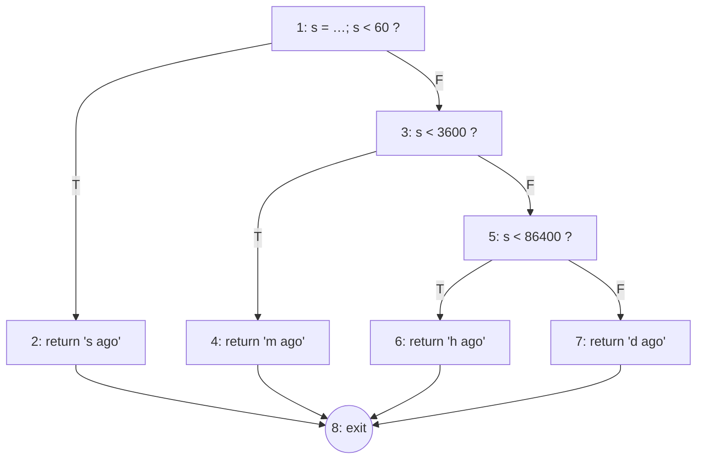

# Experiment 11 — Test Coverage Metrics & Structural Complexity

## Aim
Measure how much of ParkFlow's code the tests exercise, and measure the code's
structural complexity (cyclomatic complexity, coupling).

## 1. Coverage metrics

| Metric | Definition |
|---|---|
| Statement / line coverage | executed lines ÷ executable lines |
| Branch (decision) coverage | taken branch outcomes ÷ all branch outcomes |
| Function coverage | called functions ÷ all functions |
| Path coverage | executed independent paths ÷ basis paths (V(G)) |

### 1.1 Tool and command

Node's built-in V8 coverage, no extra packages:

```bash
npm run coverage
# = node --test --experimental-test-coverage --test-coverage-include="assets/**" "tests/unit/*.test.js"
```

### 1.2 Results for the business-logic module `core/store.js`

| Run | Tests | Lines | Branches | Functions |
|---|---|---|---|---|
| Iteration 1 | 23 | 301/301 = **100 %** | 123/124 = **99.19 %** | 48/50 = **96.00 %** |
| Iteration 2 (+UT-24) | 24 | 301/301 = **100 %** | 125/126 = **99.21 %** | 50/50 = **100 %** |

```
ℹ file        | line % | branch % | funcs % | uncovered lines
ℹ    store.js | 100.00 |    99.21 |  100.00 |
```

**Gap analysis**

- *Iteration 1:* `clock()` and `dateStr()` were never called. UT-24 was added and function coverage rose from 96 % to 100 %.
- *Remaining uncovered branch:* `store.js:266`, `if (s.type === 'acc') continue;` in the live loop. The loop picks bays at random. Five mock ticks didn't pick an accessible bay, so the `true` outcome was never taken. Covering it would need an injectable random source. This is a **testability** finding: a seedable or injectable `rnd()` would make the simulation fully deterministic under test.

### 1.3 UI coverage (Selenium)

The 73 Selenium tests load all 9 routes, drive the map, the 3 booking wizard steps, the alert list, the settings tabs and the dashboard chart controls. The table engine is exercised for search, filter, sort and pagination on sessions, reservations, customers and staff. Route-level coverage is therefore complete; the function-level numbers above come from the unit tests.

| Feature area | Requirement IDs | Covered by |
|---|---|---|
| Shell, routing, fallback | FR-11 | E2E-01…04 |
| KPIs / meter | FR-1.1 | E2E-05 |
| Table engine | FR-3.2, FR-3.3 | E2E-06…10 |
| Booking | FR-4.1–4.4 | E2E-11…13 |
| Theme, palette | FR-11 | E2E-14, 15 |

**Requirement coverage:** the SRS has 33 numbered items (24 FR + 9 NFR). 14 of them have at least one automated test: FR-1.1, 1.4, 2.1, 2.4 (store side), 3.1, 3.2, 3.3, 3.5, 4.1, 4.2, 4.4, FR-11, NFR-6, NFR-9. That is **≈ 42 %**.

## 2. Structural complexity

### 2.1 Cyclomatic complexity, worked example: `ago(t)` (store.js:293)

```js
export const ago = (t) => {
  const s = Math.round((Date.now() - t) / 1000);   // 1
  if (s < 60) return `${s}s ago`;                 // 1 → 2
  if (s < 3600) return `${…}m ago`;               // 3 → 4
  if (s < 86400) return `${…}h ago`;              // 5 → 6
  return `${…}d ago`;                             // 7
};                                                // 8 (exit)
```

**Control flow graph**



| Method | Calculation | V(G) |
|---|---|---|
| Edges − Nodes + 2 | 10 − 8 + 2 | **4** |
| Predicate nodes + 1 | 3 + 1 | **4** |
| Regions | 3 enclosed + 1 outer | **4** |

**Basis paths and the test that executes each (UT-17)**

| Path | Nodes | Input | Output |
|---|---|---|---|
| P1 | 1-2-8 | now − 30 s | `30s ago` |
| P2 | 1-3-4-8 | now − 5 min | `5m ago` |
| P3 | 1-3-5-6-8 | now − 3 h | `3h ago` |
| P4 | 1-3-5-7-8 | now − 2 d | `2d ago` |

All 4 basis paths are executed, so path coverage of `ago()` is **100 %**.

### 2.2 Cyclomatic complexity of the whole code base

Measured with ESLint's `complexity` rule (each function, including arrow callbacks, is counted separately; `&&`, `||`, `??`, `?:`, `?.` and default parameters each add 1):

```bash
npx eslint@9 --no-config-lookup --rule '{"complexity":["warn",0]}' assets/js
```

| Summary | Value |
|---|---|
| Functions analysed | 363 |
| Total V(G) | 679 |
| Mean V(G) per function | **1.87** |
| Maximum V(G) | **11** |

| Risk band (SEI) | V(G) | Functions | % |
|---|---|---|---|
| Simple, low risk | 1–4 | 337 | 92.8 % |
| Moderate | 5–10 | 25 | 6.9 % |
| Complex, high risk | 11–20 | 1 | 0.3 % |
| Untestable | > 20 | 0 | 0 % |

**Most complex functions**

| V(G) | Location | Function | Comment |
|---|---|---|---|
| 11 | store.js:34 | zone loop body in `buildSlots` | bay type + status rules; candidate to split into `slotType(i)` and `initialStatus()` |
| 10 | booking.js:24 | `steps()` (wizard header) | ternaries in the template |
| 10 | booking.js:102 | `next.onclick` (wizard controller) | validation + commit; covered by E2E-11/12 |
| 10 | alerts.js:14 | alert list painter | filter + severity ternaries |
| 9 | dashboard.js:168 | session table painter | |
| 9 | ui.js:46 | `modal()` | |
| 8 | app.js:142 | `navigate()` (router) | covered by E2E-03/04 |
| 7 | store.js:261 | live-tick callback | |
| 5 | store.js:206 | `metrics()` | 100 % branch-covered |
| 4 | store.js:289 / 293 | `compact()` / `ago()` | BVA / basis-path tested |

**Per module**

| Module | Functions | Max V(G) | Mean V(G) |
|---|---|---|---|
| app.js | 47 | 8 | 1.70 |
| core/store.js | 50 | 11 | 1.98 |
| core/ui.js | 50 | 9 | 1.90 |
| core/datatable.js | 24 | 7 | 2.29 |
| core/icons.js | 2 | 3 | 2.00 |
| views/booking.js | 19 | 10 | 3.00 |
| views/alerts.js | 15 | 10 | 2.33 |
| views/lotmap.js | 34 | 7 | 2.21 |
| views/dashboard.js | 31 | 9 | 1.84 |
| views/settings.js | 17 | 5 | 1.59 |
| views/staff.js | 8 | 4 | 1.50 |
| views/analytics.js | 11 | 3 | 1.36 |
| views/sessions.js | 16 | 4 | 1.25 |
| views/bookings.js | 21 | 4 | 1.24 |
| views/customers.js | 18 | 4 | 1.22 |

### 2.3 Coupling: fan-in, fan-out and Henry–Kafura information flow

From the `import` graph (fan-in = modules that import it, fan-out = modules it imports).
Henry–Kafura IF = LOC × (fan-in × fan-out)².

| Module | LOC | Fan-in | Fan-out | IF |
|---|---|---|---|---|
| app.js | 241 | 1 (index.html) | 14 | 47,236 |
| core/ui.js | 241 | 12 | 1 | 34,704 |
| views/dashboard.js | 201 | 2 | 3 | 7,236 |
| core/datatable.js | 106 | 4 | 2 | 6,784 |
| views/sessions.js | 59 | 1 | 5 | 1,475 |
| views/booking.js | 117 | 1 | 3 | 1,053 |
| core/store.js | 264 | 11 | 0 | 0 |
| core/icons.js | 42 | 13 | 0 | 0 |

**Interpretation:** `store.js` and `icons.js` have high fan-in and zero fan-out.
They are stable foundations, and a change to them affects many modules, so they carry
the most unit tests. `app.js` has the highest information flow because it is the
composition root. That is expected for a router. `sessions.js → dashboard.js` (to reuse
`sessionModal`) is the only view-to-view dependency, and moving `sessionModal` into its own
module would remove it.

## Result
Business logic reaches 100 % line, 99.21 % branch and 100 % function coverage,
and `ago()` has 100 % basis-path coverage. 92.8 % of the 363 functions are low-risk
(V(G) ≤ 4). Only one function reaches V(G) = 11, and it is flagged for refactoring.
