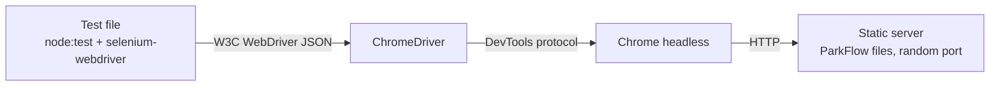

# Experiment 12 — Designing Test Suites & Hands-on Selenium

## Aim
Organise ParkFlow's tests into suites and automate browser testing with Selenium WebDriver.

## 1. Tool selection

Only **Selenium WebDriver** is used for UI testing in this project.

| Tool | Used? | Reason |
|---|---|---|
| **Selenium WebDriver** (`selenium-webdriver` 4.x, Chrome) | ✅ Yes | Standard W3C WebDriver automation, runs in headless Chrome |
| Playwright | ❌ No | Tried earlier; removed on request so only Selenium is used |
| Cypress | ❌ No | Not used; Selenium is the requested tool |
| Postman | ❌ No | ParkFlow v1.0 has no HTTP API to test |
| Jira | ❌ No | An issue tracker, not a test runner. The defect log in Experiment 9 records the bugs |

**Selenium components used**

| Component | Purpose |
|---|---|
| WebDriver protocol | Drives the browser over the W3C JSON protocol |
| ChromeDriver | Chrome's driver, fetched automatically by Selenium Manager |
| `By`, `until`, `Key` | Locators, explicit waits, keyboard input |
| `chrome.Options` | Headless mode, window size, mobile emulation (Pixel 7), console logging |



**Locators:** `By.css` only. The app exposes stable hooks (`#pg-title`, `[data-route=…]`,
`[data-q]`, `[data-f=status]`, `[data-slot]`, `.modal #next`), so tests don't use fragile XPath.

**Waits:** explicit waits only (`until.elementLocated`, `until.elementIsVisible`, and
`driver.wait(condition, timeout)`). Tests don't use fixed sleeps.

## 2. Test suite design

| Suite file | Area (requirement) | Tests |
|---|---|---|
| [app.e2e.test.js](../../tests/e2e/app.e2e.test.js) | Original smoke, table, booking and preference tests | 15 |
| [navigation.e2e.test.js](../../tests/e2e/navigation.e2e.test.js) | Every page loads with no JS errors; Ctrl+B (FR-1, FR-11) | 10 |
| [map.e2e.test.js](../../tests/e2e/map.e2e.test.js) | Live bay map, filters, reserve/release (FR-2) | 6 |
| [tables.e2e.test.js](../../tests/e2e/tables.e2e.test.js) | Search, filters, sort, paging on sessions, reservations, customers, staff (FR-3, FR-5, FR-6, FR-9) | 9 |
| [booking-wizard.e2e.test.js](../../tests/e2e/booking-wizard.e2e.test.js) | Booking wizard steps, totals, saved record, Back, Esc (FR-4) | 6 |
| [alerts-settings-dashboard.e2e.test.js](../../tests/e2e/alerts-settings-dashboard.e2e.test.js) | Alerts (FR-8), settings (FR-10), dashboard (FR-1) | 11 |
| [known-defects.e2e.test.js](../../tests/e2e/known-defects.e2e.test.js) | Six open defects, written as the behaviour the SRS requires (todo) | 6 |
| [responsive.e2e.test.js](../../tests/e2e/responsive.e2e.test.js) | Pixel 7 emulation: no horizontal scroll on 9 pages; drawer menu (NFR-3) | 10 |
| **Total** | | **73** |

Unit suites (not Selenium): 24 tests in [tests/unit/store.test.js](../../tests/unit/store.test.js), listed in Experiment 10.

**Suite properties**
- **Independent:** each test reloads the page and clears `localStorage`, so the seeded store starts fresh and tests can run in any order.
- **Self-contained:** each suite starts its own static HTTP server on a random free port. No `npm start` is needed.
- **Sequential:** `npm run test:e2e` uses `--test-concurrency=1`, so one browser runs at a time.
- **Headless:** `--headless=new`, so the suite runs in CI.

## 3. Implementation

Shared helpers are in [tests/e2e/helpers.js](../../tests/e2e/helpers.js).

### 3.1 Driver setup
```js
export function newDriver({ mobile = false } = {}) {
  const opts = new chrome.Options().addArguments('--headless=new');
  if (mobile) opts.setMobileEmulation({ deviceName: 'Pixel 7' });
  else opts.addArguments('--window-size=1440,900');
  opts.setLoggingPrefs({ browser: 'ALL' });
  return new Builder().forBrowser('chrome').setChromeOptions(opts).build();
}
```

### 3.2 Reading the app's state
Some checks read the app's live store module from inside the browser:
```js
export const db = (driver, fn, arg = null) =>
  driver.executeScript(`return import('./assets/js/core/store.js').then(m => (${fn.toString()})(m, arguments[0]));`, arg);

// e.g. after reserving a bay, assert the data, not just the toast
assert.equal(await db(driver, (m, id) => m.DB.slots.find(s => s.id === id).status, id), 'reserved');
```

### 3.3 Example: search narrows the table (E2E-06)
```js
test('E2E-06 search narrows the table to matching rows', async () => {
  const before = await text('[data-count]');
  await (await $('[data-q]')).sendKeys('SES-8000');
  await driver.wait(async () => (await text('[data-count]')) === '1 record', 3000);
  assert.notEqual(before, '1 record');
});
```

### 3.4 Example: total = rate × hours (E2E-BK-03)
```js
await click(driver, '.modal [data-lot="L2"]');          // ₹80/hr
await click(driver, '.modal #next');
await click(driver, '.modal [data-slot]');
await click(driver, '.modal #hrs option[value="3"]');   // 3 hours
await click(driver, '.modal #next');
// total read from the summary row
assert.equal(total, '₹240');
```

### 3.5 Example: a known defect as a todo test (E2E-DEF-02)
```js
test('E2E-DEF-02: Cancel Booking should cancel the reservation (FR-5)',
  { todo: 'DEF-02 open: Cancel only shows a toast' }, async () => {
  ...
  await driver.wait(async () => (await db(driver, (m, id) =>
    m.DB.reservations.find(r => r.id === id).status, id)) === 'cancelled', 2000,
    'reservation status did not change to cancelled');
});
```
Node's `todo` option runs the test and reports its failure without failing the suite.
When the bug is fixed, the test passes and the `todo` marker can be removed.

## 4. Running

```bash
npm install          # installs selenium-webdriver (Selenium Manager fetches ChromeDriver)
npm run test:e2e     # all 73 Selenium tests, one at a time
```

## 5. Results (27 Oct 2026, Chrome 156 headless, macOS)

Full output: [results/selenium-run.txt](results/selenium-run.txt)

| Result | Count |
|---|---|
| Tests run | **73** |
| Passed | **67** |
| Failed | **0** |
| Todo (known defects, failing for the documented reason) | **6** |

Each todo test fails for the defect it names:

| Test | Defect | What the test saw |
|---|---|---|
| E2E-DEF-01 | Check Out does not complete the session | status did not change to `completed` (timeout) |
| E2E-DEF-02 | Cancel Booking does not cancel | status did not change to `cancelled` (timeout) |
| E2E-DEF-04 | Start time ignored | arrival was 02:20 (now + 10 min), not 23:30 |
| E2E-DEF-06 | Badge lags after Ack | badge still showed 4, expected 3 |
| E2E-DEF-07 | Duplicate listeners | 2 dialogs open after one click, expected 1 |
| E2E-DEF-08 | Payment method clears fields | name read back as `''`, expected `Asha Rao` |

Summary by suite (all passing unless noted):

| Suite | Passed | Todo |
|---|---|---|
| app.e2e (original) | 15 | 0 |
| navigation | 10 | 0 |
| map | 6 | 0 |
| tables | 9 | 0 |
| booking-wizard | 6 | 0 |
| alerts-settings-dashboard | 11 | 0 |
| responsive (Pixel 7) | 10 | 0 |
| known-defects | 0 | 6 |

The 24 unit tests also pass (see [results/unit-run.txt](results/unit-run.txt)).

## 6. Problems met while automating (and fixes)

| Symptom | Root cause | Fix |
|---|---|---|
| `getText()` returned `''` for table cells | Rows fade in (`animation: feedIn … backwards`), and `getText()` returns only visible text | Read `textContent` through `executeScript` |
| `ElementClickInterceptedError` on the pager | The pager sits below the fold in `.scroll`, which uses `scroll-behavior: smooth`, so the click landed mid-scroll | `scrollIntoView({block:'center', behavior:'instant'})` before each click |
| Console error on every page | The sandbox is offline, so the Google Fonts stylesheet fails to load | Ignore failed loads from `fonts.googleapis.com` and `fonts.gstatic.com` only. All other console errors still fail the test |
| `ElementNotInteractableError` in the mobile drawer | The drawer slides in with a CSS transition, and the click ran before it finished | Wait until the drawer's `left` edge is ≥ 0 before clicking a link in it |
| Time and range inputs won't take `sendKeys` reliably | Native `<input type="time">` and `<input type="range">` need exact values | Set `value` through `executeScript`, then dispatch the `input` or `change` event |

## 7. Limitations

- **One browser:** Chrome only. Firefox is not installed on the test machine, and Selenium would need `geckodriver` plus Firefox to add it.
- **Todo tests are not regression blockers:** a todo test that fails is reported but doesn't fail the run. Remove the `todo` option as each defect is fixed.
- **Timing-dependent check:** the rail meter updates on a 4 s timer (DEF-06), so the facility-meter test allows up to 6 s.

## Result
Ten suites were designed. Selenium was the only UI tool used, and 73 WebDriver tests were
implemented. 67 pass, and 6 are todo tests that reproduce documented defects. Each of
those six fails for the reason stated in the defect log.
